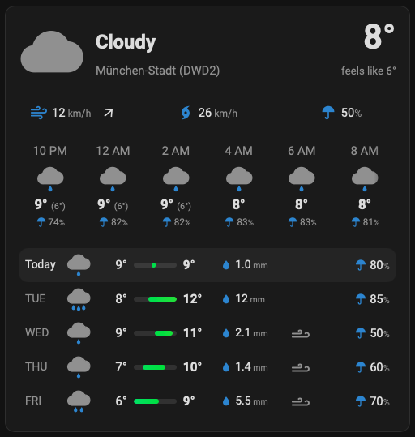
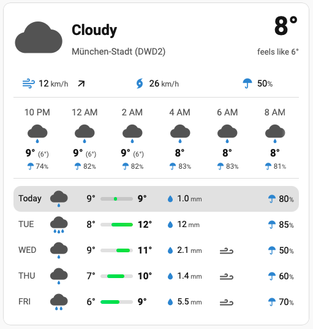
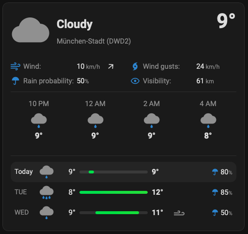
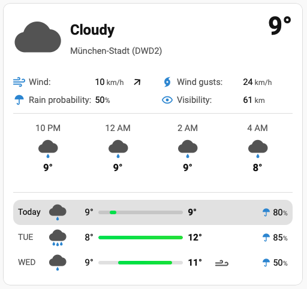

# Clean Weather Card

A clean, **read-only** weather card for [Home Assistant](https://www.home-assistant.io/). It works with any `weather.*` entity, so you pick the integration (DWD, Met.no, OpenWeatherMap, ...) in the card editor.

I created this card because I was missing these features in the existing weather cards:

- a very clear presentation of the weather: current conditions, hourly and daily forecasts
- rain icons that reflect the expected precipitation (light, medium, heavy, downpour)
- wind and rain probability at a glance
- easy configuration, with freely selectable attributes

<table>
  <tr>
    <td></td>
    <td></td>
  </tr>
  <tr>
    <td></td>
    <td></td>
  </tr>
</table>

## Features

- Current conditions: large icon, condition and weather service name, temperature and "feels like" (only when it differs by 2 degrees or more).
- **Shortcuts**: a multicolumn row below the header with current values (icon + value), freely selectable. Default: rain probability, wind, wind gusts.
- **Hourly forecast**: configurable interval, visible and total number of columns (drag or swipe, no scrollbar), and two selectable attributes per column.
- **Daily forecast**: configurable number of days in one or two columns, day label format, temperature (min/max or range bar), precipitation (value or bar), wind, and any number of additional attributes (one column each, icon + value). When a row is too narrow, the values on the right are hidden first.
- Rain icon: the same cloud as "cloudy" plus 1 / 2 / 3 drops or a downpour depending on the expected amount (2 drops when the amount is unknown).
- Nothing is created in Home Assistant: no helper, no automation, no sensor. Forecasts come from the `weather/subscribe_forecast` websocket subscription, the same mechanism as the built-in weather card (with a `weather.get_forecasts` fallback for integrations that do not support subscriptions).
- Units follow the entity (km/h, m/s, mph, mm, in, °C, °F). Languages: German, English, French, Spanish, Italian, Dutch, Portuguese, Polish (follows your HA language).

## Installation

Requires Home Assistant 2023.12 or newer.

### Marketplace (Home Assistant 2026.11+)

1. Open the Marketplace (previously HACS) and search for *Clean Weather Card*.
2. Install it and reload the browser. The resource is registered automatically.

On Home Assistant 2026.10 or older, install HACS and search for the card there.

### Manual

Copy `dist/clean-weather-card.js` to `config/www/` and add it as a dashboard resource (`/local/clean-weather-card.js`, type *JavaScript module*).

## Configuration

Add the card from the UI (the visual editor has a section per area) or in YAML:

```yaml
type: custom:clean-weather-card
entity: weather.munchen_stadt_dwd2
title: ""
icon_size: 96
shortcuts_display: icon
shortcuts:
  - precipitation_probability
  - wind_speed
  - wind_gust_speed
hourly:
  enabled: true
  visible_columns: 4
  total_columns: 12
  interval: 2
  main: temperature
  secondary: precipitation_probability
daily:
  enabled: true
  days: 8
  columns: 2
  day_label: day_short
  temperature: range
  precipitation: none
  wind: icon
  attributes:
    - precipitation_probability
    - humidity
```

### General

| Option | Default | Description |
|---|---|---|
| `entity` | required | Any `weather.*` entity. |
| `title` | none | Optional title. |
| `icon_size` | `96` | Size of the main icon in the header in px (20 to 100). |

### `shortcuts`

Grid of attributes shown below the header (current values); the number of columns adapts to the available width and each entry is centred in its cell. `shortcuts_display` selects `icon` (default, centred, the label is shown as a tooltip), `icon_label` (e.g. "Rain probability: 12%", left-aligned) or `label`. `shortcuts` is the list of attributes. In the editor this is a dropdown with checkboxes. An empty list hides the row. Available: `apparent_temperature`, `wind_speed`, `wind_gust_speed`, `precipitation_probability`, `humidity`, `cloud_coverage`, `uv_index`, `pressure`, `dew_point`, `visibility`.

### `hourly`

| Option | Default | Description |
|---|---|---|
| `enabled` | `true` | Show the hourly forecast. |
| `visible_columns` | `4` | Columns visible without scrolling (3 to 8). |
| `total_columns` | `8` | Total number of columns (3 to 24); the rest is reached by dragging (mouse or finger) or swiping horizontally on a trackpad; there is no scrollbar. |
| `interval` | `2` | Hours between two columns (1 to 12). The first column is `interval` hours from now, rounded to the full hour. |
| `main` | `temperature` | Main attribute (bold). `temperature_feels` shows `9° (6°)`; the feels-like value is omitted if it differs by 1° or less. |
| `main_icon` | `false` | Show the attribute icon in front of the main attribute. |
| `secondary` | `none` | Second attribute, shown below. `none` to disable. |

### `daily`

| Option | Default | Description |
|---|---|---|
| `enabled` | `true` | Show the daily forecast. |
| `days` | `5` | Number of days (1 to 14), starting with today. |
| `columns` | `1` | `1` or `2`; with 2 the days are arranged top to bottom, filling the first column first. |
| `day_label` | `day_short` | `day_short` (MON), `day_long` (Monday), `day_date` (MON 3.), `date` (14.12). The first row is always labelled "Today". |
| `temperature` | `range` | `min_max` (text), `range` (range bar: min, a bar colored cold to warm on a common scale for all days, max) or `none`. |
| `precipitation` | `none` | `value` (amount), `range` (a bar from 0 to the largest daily amount, plus the value) or `none`. |
| `wind` | `icon` | `icon` (only for strong gusts), `value` (icon, speed, direction arrow), `gust` (additionally the gust in brackets) or `none`. |
| `attributes` | `[precipitation_probability]` | List of additional attributes, one column each (always icon + value). In the editor this is a dropdown with checkboxes. An empty list disables them. |

### Attributes

Usable for `hourly.main`, `hourly.secondary` (additionally `temperature_feels`), `daily.attributes` (without `temperature`) and `shortcuts` (without `temperature` and `precipitation`). All attribute icons use the accent colour (CSS variable `--cwc-attr-color`, default blue):
`temperature`, `apparent_temperature` (feels like), `wind_speed`, `wind_gust_speed`, `precipitation`, `precipitation_probability`, `humidity`, `cloud_coverage`, `uv_index`, `pressure`, `dew_point`, `visibility`.

If the weather entity does not provide a selected attribute, it is shown as `– <unit>`. Clearing an option in the editor disables it. `apparent_temperature` is computed (wind chill below 15 °C, heat index from 26 °C) when the entity does not provide it. In the daily forecast the rain probability is the maximum of the hourly values of that day (today: from now on) when the daily forecast has none.

### Requirements on the weather entity

- Hourly columns need hourly forecasts, daily rows need daily forecasts.
- Rain probability needs an entity that provides `precipitation_probability` (for DWD this is the *DWD Weather* custom integration, not the core one).

### Styling

The card follows your theme. Weather icons use the theme's secondary text color; override it with the `--cwc-icon-color` CSS variable (for example with card-mod).

## Behaviour details

- Wind warning level per day from the strongest gust: 1 from 50 km/h, 2 from 65 km/h, 3 from 90 km/h.
- Gust line shown when gusts are at least 40 km/h or 1.5 times the wind speed.
- Rain probability shown from 10 % (rounded to 5 %).
- Rain drops: hourly columns use the average rate (mm/h) over the hours they cover: 1 drop below 2.5 mm/h, 2 below 10, 3 below 15, downpour above (the DWD thresholds for light, strong rain and downpour warnings). Daily rows use the day total: 1 drop below 5 mm, 2 below 10, 3 below 20, downpour above. 2 drops if the amount is unknown.
- Forecasts are kept while the card is re-created, so icons do not flash on reload of the view.
- Missing forecast data is shown as `–`.

## Languages

Weekday and date formats follow the language of your Home Assistant user profile. The card texts (condition names, "Today", "feels like", attribute labels, compass directions) are translated for: German, English, French, Spanish, Italian, Dutch, Portuguese and Polish. Other languages fall back to English. Units are shown as provided by the weather entity. The visual editor is English only.

The ES / IT / NL / PT / PL translations were machine-generated, so corrections are welcome.

**Adding or fixing a language:** the texts are in one block (`const I18N`) at the top of `dist/clean-weather-card.js`. Copy the `en` block, rename it to your language code, translate the values and run:

```
node scripts/check-translations.js
```

Missing keys fall back to English. Then open a pull request.

## Development and local testing

1. Serve the file from your computer: `python3 -m http.server 8000` in the repository root.
2. In Home Assistant: Settings > Dashboards > three-dot menu > Resources > add
   `http://<your-computer-ip>:8000/dist/clean-weather-card.js?v=1` as *JavaScript module*
   (use `?v=2`, `?v=3`, ... after each change to bypass the cache; a hard refresh also works).
   If Home Assistant runs on HTTPS, the browser blocks the plain-HTTP resource: copy the file to `config/www/` instead (e.g. with the Samba or SSH add-on) and use `/local/clean-weather-card.js?v=1`.
3. Edit a dashboard > Add card > *Clean Weather Card*.
4. Check the browser console (F12) for errors.

Before pushing: `node --check dist/clean-weather-card.js`. The `Validate` workflow runs the Marketplace check (`category: plugin`) on every push.

## Releasing

Publish a **GitHub release** (not just a tag), e.g. `v1.0.0` (mark it as pre-release for alphas, e.g. `v1.0.0-alpha.1`); its tag is the version users see. Without a release, users get the latest commit. The README must contain at least one image (the Marketplace catalog checks this).

## License

MIT
